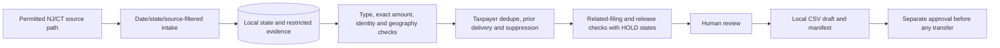

# York Tax Lien Pilot

**Client project under Plinko Solutions | Validation first, agreement paused | Updated 2026-11-07**

Decide, on real evidence, whether a narrowly scoped New Jersey and Connecticut federal tax lien research and referral-delivery workflow is worth agreeing to. The intended output is a reviewed CSV of unique eligible taxpayers associated with recorded IRS lien notices of at least USD 10,000, delivered through an access-restricted folder. Plinko researches sources, reviews eligibility and prepares restricted delivery files. The firm owns taxpayer outreach, intake, professional verification, services, follow-up and collections. A researched filing is not an interested prospect, appointment or paying client.

## Current status

**Validation, not delivery.** Agreement finalization is paused while source paths, a local MVP and operating economics are validated. Existing agreement drafts are reference material, not permission to launch. Any remaining two-to-three-week workback is provisional, not a promised launch date.

**No pipeline is live.** Source integrations, data transfer, paid access and billing are disabled. No source permission, recurring volume, client acceptance or professional/tax clearance is represented as verified.

This is a public repository: keep the private agreement, correspondence, credentials, taxpayer records, source documents, client financial logs and professional advice out of GitHub. Only sanitized technical findings and aggregate counts belong here.

## Working territory

New Jersey and Connecticut only, as directed by the product owner.

| Source | Role | Status |
|---|---|---|
| Connecticut statewide state lien sources | Primary | Pending; amount path unproven |
| Bergen County, NJ | Primary | Pending; amount, mailing-field and recurring access unproven |
| Essex County, NJ | Optional, inactive | Not an automatic fallback; IRS origin not verified |

Complete statewide New Jersey coverage is not claimed. New York, Texas and other states are outside this working scope. The earlier four-county Texas plan in this repository is superseded; see [agreement reconciliation](docs/11-agreement-reconciliation.md).

## Decision this work must produce

One explicit recommendation, backed by actual evidence:

| Outcome | Meaning |
|---|---|
| GO TO AGREEMENT | A permitted source-to-local-review path works in each state, field checks pass, and workload and economics are acceptable |
| NARROW SCOPE | Only one state, or a smaller target, is viable |
| NO-GO | No permitted amount path, unsustainable effort, or unacceptable economics |
| NEEDS OWNER INPUT | A decision only the product owner or firm can make blocks progress |

A technical go requires a real permitted source-to-local-review slice and an independent field comparison. Volume, founder workload and commercial viability are separate acceptance questions. Fifty unique eligible taxpayers per week is a conditional target, not guaranteed supply; a lower target is an open decision if the region cannot support it.

## Team reading order

1. [Client charter](docs/01-client-charter.md)
2. [Source validation](docs/02-source-validation.md)
3. [Architecture](docs/03-solution-architecture.md)
4. [Data contract](docs/04-data-contract.md)
5. [Cost and collections](docs/05-roi-and-cost.md)
6. [Validation and delivery plan](docs/06-delivery-plan.md)
7. [Operations](docs/07-operations.md)
8. [Quality and security](docs/08-quality-security.md)
9. [Team walkthrough](docs/09-team-walkthrough.md)
10. [Pending decisions and launch gates](docs/10-decisions-and-launch-gates.md)
11. [Agreement reconciliation](docs/11-agreement-reconciliation.md)
12. [Execution backlog](planning/backlog.md)

## Intended workflow



Adapt the existing lien-automation engine rather than building another CRM, dashboard or portal. External transfer stays disabled by default. Do not inherit the earlier engine's spreadsheet destinations, notifications or schedulers. Synthetic fixtures must be labelled synthetic and cannot establish live-source success.

## Start here

1. Read the [source validation](docs/02-source-validation.md) gaps. The permitted document and exact-amount path is the first gate.
2. Work the [backlog](planning/backlog.md) in order: source feasibility, offline MVP, permitted integration, independent QA and workload, decision.
3. Run one writer per checkout. Confirm task ownership before editing shared work in progress.

Approving repository updates does not approve the agreement, source access, data sharing, spending, billing or live operation.

## Validate planning assets

```bash
python3 scripts/validate-planning.py
git diff --check
```

These checks verify internal links, disabled policy, the NJ/CT source registry, draft counts and header lists. They do not test live sources, application behavior, security configuration, client approval or professional legality.
