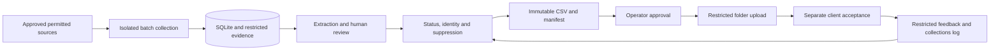

# York Tax Lien Pilot

**Fresh-client project | Three-week operator-assisted pilot | Updated 2026-10-26**

Build a reviewed weekly CSV of unique taxpayer prospects associated with recent federal tax lien notices of at least USD 10,000 across Dallas, Collin, Denton and Bexar counties, Texas. Deliver through an agreed access-restricted shared folder and reconcile acceptance and actual collections in a lightweight restricted log.

## Current status

**Planning assets only. The county adapters, extraction pipeline, scheduler, upload workflow and financial reconciliation are not implemented or live.** Example configuration is disabled; documents and issue templates do not enforce runtime controls. No source permission, host capacity, weekly volume, client acceptance or professional/tax clearance is represented as verified.

This is a public repository: keep the private agreement, credentials, taxpayer records, source documents, client financial logs and professional advice out of GitHub. The previous project is not a deployment target; do not copy its secrets, cookies, databases or client records. Nothing in the previous repository is modified by this update.

## Three-week success

- Working, operator-assisted collection, evidence review, deduplication, suppression and CSV delivery.
- At least one complete county path by the end of week one; all four remain the agreement scope. One adapter alone does not satisfy that scope.
- Manual assistance only where permitted and explicitly accepted with sustainable capacity. An unavailable county requires a written scope change or pause.
- First approved real delivery targeted around working day 8; repeat about one week later when the agreed calendar permits. Handoff by day 15 is conditional on the gates, not a guaranteed launch date.
- Fifty unique reviewable taxpayers is a conditional weekly target, not guaranteed supply or a four-week rolling average. Report shortfalls; never pad them.

The private draft's planning allowance begins after execution. Start date, working calendar and approval status remain unconfirmed; no calendar deadline is silently inferred from this publication.

## Team reading order

1. [Client charter](docs/01-client-charter.md)
2. [Source validation](docs/02-source-validation.md)
3. [Architecture](docs/03-solution-architecture.md)
4. [Data contract](docs/04-data-contract.md)
5. [Cost and collections](docs/05-roi-and-cost.md)
6. [15-day delivery plan](docs/06-delivery-plan.md)
7. [Operations](docs/07-operations.md)
8. [Quality and security](docs/08-quality-security.md)
9. [Team walkthrough](docs/09-team-walkthrough.md)
10. [Pending decisions and launch gates](docs/10-decisions-and-launch-gates.md)
11. [Agreement reconciliation](docs/11-agreement-reconciliation.md)
12. [Execution backlog](planning/backlog.md)

## Intended workflow



Proposed stack: supported patched Node LTS, TypeScript CLI, SQLite, permitted direct requests and Playwright only if needed, PDF text extraction and narrow local OCR, systemd, persistent isolated storage. An existing approved shared folder and manual upload are sufficient; no mailbox API, Drive API, CRM migration, public dashboard, paid enrichment, automated outreach or runtime LLM is required.

## Start here

Assign two focused technical contributors, a daily reviewer/operator and a product owner available for same-day decisions, or explicitly reduce scope. Begin client acceptance decisions, all-four-county access investigation and the technical foundation in parallel. Freeze new features on day 12; preserve evidence, review, suppression, recipient control and recovery regardless of deadline pressure.

Read the [backlog](planning/backlog.md) and [GitHub issues](https://github.com/Jmx097/york-tax-lien-pilot/issues). Approving repository updates does not approve the agreement, source access, data sharing, spending, billing or live operation.

## Validate planning assets

```bash
python3 scripts/validate-planning.py
git diff --check
```

These checks verify internal links, disabled policy, draft counts and header lists. They do not test live sources, application behavior, security configuration, client approval or professional legality.
