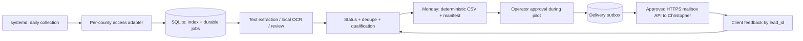

# York Tax Lien Pilot

**Fresh-client delivery project | Private | Planning baseline: 2026-10-26**

Build a low-incremental-cost workflow that collects federal tax lien notices from Dallas, Collin, Denton and Bexar counties and produces a reviewed weekly CSV for Christopher York. Run a single isolated batch application on the already-paid Droplet. Use Bright Data only where access tests justify it and permission allows it.

## Current status

This repository contains the solution design, contracts, deployment templates and implementation backlog. **The county adapters, extraction pipeline and delivery integration are not implemented or live.** Templates do not activate timers, create accounts, spend money, or send data. All county integrations start disabled. Nothing in `Jmx097/lien-automation-v2` has been modified.

The prior repository is a reference, not a dependency or deployment target. Its [package manifest](https://github.com/Jmx097/lien-automation-v2/blob/main/package.json) identifies a Node/TypeScript project with Playwright and SQLite dependencies; its [scraper folder](https://github.com/Jmx097/lien-automation-v2/tree/main/src/scraper) has no Texas county adapter in the inspected listing. Existing production readiness is not assumed.

## Non-negotiable distinctions

- Fifty raw filings are not fifty unique, qualified prospects. Target the latter unless the client explicitly signs a filings-based definition.
- A shared portal family is an opportunity for reusable code, not proof of identical requests, free images or automation permission.
- No verified county counts or conversion data are available at this baseline. Earlier population-based estimates are not a launch forecast.
- Recorded notice amount is not current IRS payoff balance, service fee, or probability of conversion.
- Never guarantee fifty per week before a measured, deduplicated pilot. Never pad with releases, duplicates or stale backfill.

## Team reading order

1. [Client charter](docs/01-client-charter.md): product scope and acceptance gates.
2. [Source validation](docs/02-source-validation.md): evidence and the first investigation.
3. [Solution architecture](docs/03-solution-architecture.md): modules, execution, delivery and failure handling.
4. [Data contract](docs/04-data-contract.md): prospect identity, amounts and CSV rules.
5. [ROI and cost](docs/05-roi-and-cost.md): ranking, cost controls and measurement.
6. [Delivery plan](docs/06-delivery-plan.md): owners, estimates, dependencies and schedule.
7. [Operations](docs/07-operations.md): deployment, incidents and rollback.
8. [Quality and security](docs/08-quality-security.md): tests and production controls.
9. [Team walkthrough](docs/09-team-walkthrough.md): meeting agenda and decision checklist.

## Intended workflow

**Proposed stack:** Node 24 LTS, TypeScript, SQLite, Playwright only when needed, Poppler/Tesseract for local extraction, systemd, one persistent local state directory and an existing approved HTTPS email API. No new database service, Redis, Kubernetes, CRM, dashboard, paid enrichment or runtime LLM.

## Start here

The first three build issues establish the client contract, validate access/images on all four counties, and measure four complete historical weeks. The product owner must resolve the recipient, sender API, acceptable debt band, definition of a lead, budget and lawful outreach policy before live delivery. Unknowns are intentional launch gates, not decisions silently made on the client's behalf.

See [all build issues](https://github.com/Jmx097/york-tax-lien-pilot/issues). Reuse old code selectively only after tests and secret/PII review; never copy production `.env`, databases, sheets, cookies or client records into this repository.
